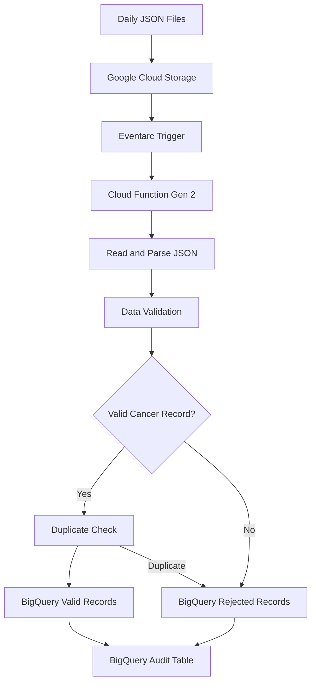

# Healthcare Event-Driven Data Ingestion Pipeline

## 1. Project Overview

This project implements an event-driven healthcare data ingestion pipeline using Google Cloud Platform (GCP).

The pipeline processes daily clinical patient records in JSON format, validates incoming records, identifies cancer-related patient data, rejects invalid or duplicate records, and stores the results in BigQuery.

The solution uses Google Cloud Storage, Eventarc, Cloud Functions (2nd Generation), and BigQuery to automate data ingestion and validation.

### Project Objectives

- Automate ingestion of daily healthcare JSON files.
- Trigger processing automatically when a file is uploaded to Google Cloud Storage.
- Validate patient information and mandatory fields.
- Identify cancer-related records using diagnosis codes.
- Detect duplicate patient records.
- Store valid records and rejected records separately.
- Maintain an audit trail for every processed file.


## 2. Solution Architecture

The pipeline follows an event-driven architecture:



## 3. Google Cloud Services Used

| GCP Service | Purpose |
|---|---|
| Google Cloud Storage | Stores incoming clinical JSON files |
| Eventarc | Detects new file uploads and triggers processing |
| Cloud Functions Gen 2 | Executes Python validation and ingestion logic |
| BigQuery | Stores valid, rejected, and audit records |
| Cloud Shell | Used for development, deployment, and testing |


## 4. Data Validation Rules

Each incoming patient record is validated using Python before insertion into BigQuery.

### Mandatory Field Validation

- `patient_id`: Must be present and non-empty.
- `hospital_id`: Must be present and non-empty.
- `diagnosis_code`: Must be present and non-empty.
- `diagnosis_date`: Must follow the YYYY-MM-DD format.

### Business Validation

- Only cancer-related diagnosis codes are accepted.
- The implementation uses a simplified ICD-10-CM cancer code pattern (C00-C97).
- Duplicate patient IDs within the same file are rejected.
- Patient IDs already present in the valid BigQuery table are rejected.
- Optional fields such as disease, treatment, and doctor must be strings when provided.
- Malformed JSON records are rejected.

### Rejection Scenarios

| Scenario | Expected Result |
|---|---|
| Missing patient ID | Rejected |
| Missing hospital ID | Rejected |
| Invalid diagnosis date | Rejected |
| Non-cancer diagnosis code | Rejected |
| Duplicate patient ID | Rejected |
| Malformed JSON | Rejected |
| Valid cancer patient record | Accepted |

## 5. BigQuery Tables

The pipeline uses the following three BigQuery tables in the `healthcare_db` dataset.

### 5.1 clinical_cancer_patients

Stores validated, unique cancer patient records.

| Column | Data Type |
|---|---|
| patient_id | STRING |
| hospital_id | STRING |
| diagnosis_code | STRING |
| disease | STRING |
| diagnosis_date | DATE |
| treatment | STRING |
| doctor | STRING |
| source_file | STRING |
| ingestion_timestamp | TIMESTAMP |

### 5.2 clinical_rejected_records

Stores rejected records and their rejection reasons.

| Column | Data Type |
|---|---|
| patient_id | STRING |
| source_file | STRING |
| raw_record | STRING |
| rejection_reason | STRING |
| rejected_timestamp | TIMESTAMP |

### 5.3 clinical_ingestion_audit

Tracks the processing status and record counts for each input file.

| Column | Data Type |
|---|---|
| file_name | STRING |
| total_records | INT64 |
| valid_records | INT64 |
| rejected_records | INT64 |
| processing_status | STRING |
| processed_timestamp | TIMESTAMP |


## 6. Deployment and Configuration

### GCP Configuration

| Configuration | Value |
|---|---|
| GCP Project ID | project-46c5290c-f673-44aa-941 |
| Region | us-central1 |
| GCS Bucket | healthcare-clinical-data-943204118280 |
| BigQuery Dataset | healthcare_db |
| Cloud Function | healthcare-clinical-ingestion |
| Runtime | Python 3.12 |
| Function Generation | Gen 2 |

### Deployment Command

The Cloud Function was deployed using:

```bash
gcloud functions deploy healthcare-clinical-ingestion \
  --gen2 \
  --runtime=python312 \
  --region=us-central1 \
  --source=cloud_function \
  --entry-point=process_clinical_file \
  --trigger-bucket=healthcare-clinical-data-943204118280 \
  --service-account=943204118280-compute@developer.gserviceaccount.com \
  --memory=256Mi \
  --timeout=120s \
  --max-instances=1 \
  --concurrency=1


## 7. Testing and Execution

Four sample JSON files were uploaded to the GCS bucket.

The Cloud Function automatically processed each uploaded file through Eventarc.

### Sample Input Files

1. clinical_data_2026_11_10.json
2. clinical_data_2026_11_11.json
3. clinical_data_2026_11_12.json
4. clinical_data_2026_11_13.json

### Test Scenarios

The test data included:

- Valid cancer patient records
- Non-cancer diagnosis codes
- Invalid diagnosis dates
- Missing mandatory fields
- Duplicate patient IDs

### Execution Flow

1. Upload JSON files to the GCS `raw/` folder.
2. Eventarc detects the new file upload.
3. Cloud Function is triggered automatically.
4. Python reads and parses the JSON records.
5. Records are validated against mandatory fields and business rules.
6. Valid cancer records are checked for duplicates and inserted into BigQuery.
7. Invalid and duplicate records are inserted into the rejected records table.
8. Processing details are recorded in the audit table.


## 8. Final Execution Results

After processing all four input files, the following results were verified in BigQuery.

### Overall Processing Summary

| Metric | Result |
|---|---:|
| Total input files | 4 |
| Total records processed | 12 |
| Valid cancer patient records | 7 |
| Unique patient records | 7 |
| Rejected records | 5 |
| Successfully processed files | 4 |

### Processing Results

| File Name | Total Records | Valid | Rejected |
|---|---:|---:|---:|
| clinical_data_2026_11_10.json | 3 | 2 | 1 |
| clinical_data_2026_11_11.json | 3 | 2 | 1 |
| clinical_data_2026_11_12.json | 3 | 2 | 1 |
| clinical_data_2026_11_13.json | 3 | 1 | 2 |
| **Total** | **12** | **7** | **5** |

### Verification

The following checks were performed using BigQuery SQL:

- Verified the total number of valid patient records.
- Verified that all valid patient IDs are unique.
- Verified the number of rejected records.
- Verified all four files have SUCCESS status in the audit table.
- Verified the total number of processed records.


## 9. Project Conclusion

The healthcare event-driven ingestion pipeline was successfully implemented and tested on Google Cloud Platform.

The solution demonstrates:

- Automated healthcare data ingestion using Google Cloud Storage.
- Event-driven processing using Eventarc.
- Serverless Python execution using Cloud Functions Gen 2.
- Data validation and cancer-specific filtering.
- Duplicate patient identification and rejection.
- BigQuery storage for valid and rejected records.
- File-level processing audit and monitoring.

The project successfully processed 12 records across 4 JSON files, resulting in 7 valid unique cancer patient records and 5 rejected records.

This project demonstrates practical experience in building automated, event-driven data engineering pipelines using managed GCP services.


